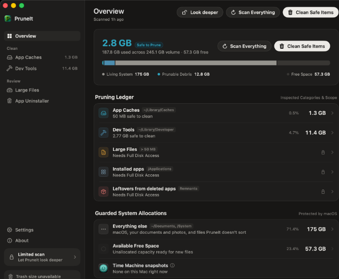
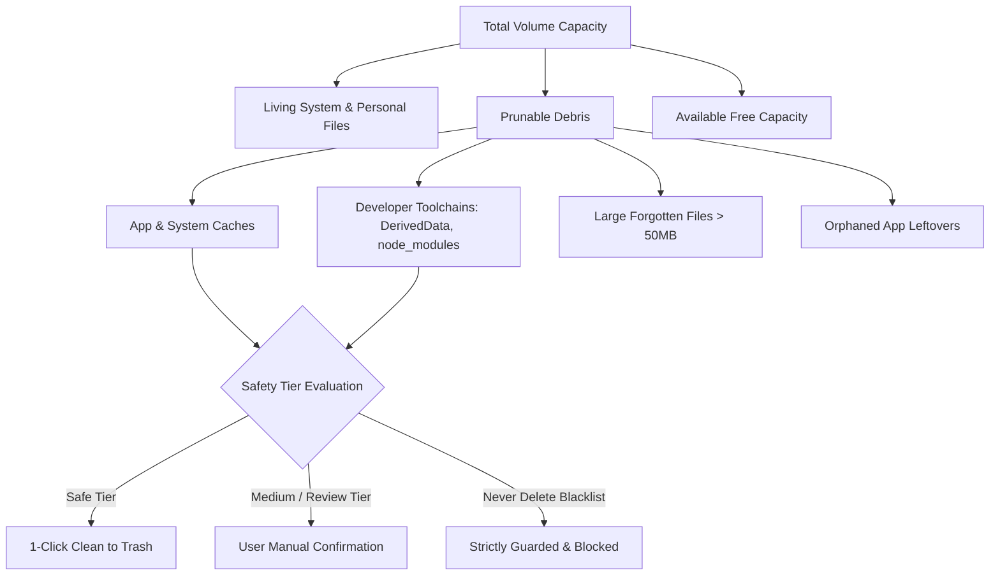

# PruneIt | Native macOS Precision Storage Cleaner

[](https://apple.com/macos)
[](https://swift.org/)
[](https://developer.apple.com/xcode/)
[-purple?style=flat-square)](https://apple.com)
[](LICENSE)
[](https://github.com/RoyalLit/PruneIt)

> Built with purpose by Pahul.

**PruneIt** is a native macOS precision storage cleaner built for all Mac users — from everyday users and creators to power users and developers. It discovers unnecessary application and system caches, orphaned leftovers, large forgotten files, simulator runtimes, and developer build artifacts — and safely moves them to the Trash (or removes system artifacts permanently via native system APIs).

PruneIt runs **100% on-device** with zero subscriptions, zero tracking, and zero telemetry.

---

## 🖼️ Product Showcase

<div align="center">
  
</div>

---

## 🌟 Vision & Value Proposition

Traditional storage cleaners are bloated, aggressive, subscription-gated black boxes that treat your personal files and caches like generic junk. **PruneIt** is built from the ground up as a **precision storage cleaner for everyone**:

- **🔒 Strict Inviolable Safety**: Centralized `DeletionSafetyPolicy` prevents accidental deletion of project files, active git repositories, shell configurations, and critical user roots.
- **🗑️ Trash-First Philosophy**: Moves reclaimable items to the Trash by default so you can inspect and restore anything before permanently emptying.
- **⚡ Smart Comprehensive Scanners**: First-class detection for everyday app caches, system leftovers, large forgotten files, as well as developer toolchains (`node_modules`, `DerivedData`, `.gradle`, Cargo, Docker, etc.).
- **🤖 Local AI & Modern Runtimes**: Specialized, guarded cleanup for Ollama, LM Studio, Hugging Face model stores, and Apple Intelligence assets.
- **🎨 Precision Modern Design**: Architectural three-tier storage breakdown (`Living System`, `Prunable Debris`, `Available Capacity`) with monospaced metrics, dark mode support, and full keyboard navigation.

---

## 🏛️ System Architecture & Storage Strata



---

## ⚡ Core Features

| Feature | Description | Safety Level |
| :--- | :--- | :---: |
| **Storage Strata (The Prune Horizon)** | 3-tier architectural capacity breakdown (`Living System`, `Prunable Debris`, `Available Capacity`) replacing generic rainbow bars. | 🟢 Safe |
| **Developer Cache Cleaner** | Reclaims space from Xcode `DerivedData`, `node_modules`, Gradle, Rust/Cargo, Flutter, and Homebrew caches. | 🟢 Safe |
| **App Uninstaller & Leftover Hunter** | Complete app bundle removal and detection of orphaned support files (`Application Support`, `Containers`, `Preferences`). | 🟡 Review First |
| **Large Files Inspector** | Rapid multi-threaded scanner identifying forgotten disk hogs with native QuickLook and thumbnail previews. | 🟡 Review First |
| **Runtime & Model Management** | Safe removal of Xcode Simulator runtimes and local AI models (Ollama, LM Studio, Hugging Face). | 🟡 Review First |
| **Guarded System Allocations** | Guarded visibility and management for Time Machine local snapshots (`tmutil`) and system structures. | 🔒 Guarded |
| **Menu Bar Mode** | Lightweight, high-performance status bar companion for background health and fast scans. | 🟢 Safe |

---

## 📥 Installation & Setup

### Prebuilt Release (Recommended)

1. Download the latest release `.dmg` from [GitHub Releases](https://github.com/RoyalLit/PruneIt/releases).
2. Open the `.dmg` and drag **PruneIt.app** into your **Applications** folder.
3. Launch PruneIt. (If macOS Gatekeeper displays an unidentified developer prompt on first launch, open via **Right Click → Open** or go to **System Settings ▸ Privacy & Security** and click **Open Anyway**).

### Granting Full Disk Access (Recommended for Full Depth)

PruneIt works out-of-the-box for user caches. To scan deep system locations (`~/Library/Application Support`, `Containers`, and root leftovers):
- Go to **System Settings ▸ Privacy & Security ▸ Full Disk Access** and toggle **PruneIt**.

### "PruneIt is damaged and can't be opened" fix

If macOS displays a damaged app alert on an unsigned build, run this once in Terminal:

```bash
xattr -cr /Applications/PruneIt.app
```

### Download Verification (SHA-256)

Every release includes a cryptographic checksum file. Verify your download:

```bash
shasum -a 256 -c PruneIt-<version>.dmg.sha256
```

---

## 🛠️ Building From Source

### Prerequisites
- macOS 13.0+ (Ventura, Sonoma, Sequoia, or later)
- Xcode 16.0+ with Command Line Tools (`xcode-select --install`)
- Node.js 18+ (for token and lint scripts)

### Build Commands

```bash
# Clone the repository
git clone https://github.com/RoyalLit/PruneIt.git
cd PruneIt

# Verify design tokens & localization tables
node scripts/lint-design-tokens.mjs
python3 scripts/check-localization.py

# Build unsigned debug binary
xcodebuild -project PruneIt.xcodeproj -scheme PruneIt -configuration Debug build CODE_SIGN_IDENTITY="" CODE_SIGNING_REQUIRED=NO CODE_SIGNING_ALLOWED=NO

# Run unit test suite
xcodebuild test -project PruneIt.xcodeproj -scheme PruneIt -only-testing:PruneItTests/OverviewPresentationTests CODE_SIGN_IDENTITY="" CODE_SIGNING_REQUIRED=NO CODE_SIGNING_ALLOWED=NO

# Package Release DMG
bash scripts/make-dmg.sh
```

---

## 📖 Documentation Ecosystem

| Resource | Description |
| :--- | :--- |
| [**Architecture Specification**](./docs/ARCHITECTURE.md) | In-depth technical breakdown of state machines, scanners, and helper daemons. |
| [**Design System**](./docs/design-system.md) | Typography scales, warm graphite palette, and component design tokens. |
| [**Safety Notes**](./docs/safety-notes.md) | Explicit allowlists, blacklists, and system path protections. |
| [**Audit Action Plan**](./docs/AUDIT_ACTION_PLAN.md) | Multi-agent production audit and technical roadmap. |

---

## 🛡️ Safety Invariants

- **Trash by Default**: Files are moved to macOS Trash using native Finder APIs, never permanently unlinked without explicit secondary confirmation.
- **System Protection**: Core directories (`/System`, `/usr`, `/Library`, `~/Library/Keychains`, `~/Library/Mail`, Documents, Pictures, Desktop) are strictly immutable.
- **Git Safety**: Active worktrees and uncommitted git repositories are detected and shielded from deletion.

---

## 👤 Author

**Pahul** ([@RoyalLit](https://github.com/RoyalLit))  
*Built with purpose for all macOS users.*

---

## 📄 License

This project is licensed under the [MIT License](LICENSE).
